# Test Case Manual UniTalk

- **Penguji:** Fitri Arfiana (2401020135), QA
- **Lingkungan:** backend Laravel `http://127.0.0.1:8000`
- **Tanggal uji:** 19 November 2026
- **Data uji:** akun demo di PRD Bagian 6.1 (password: `password123`)
- **Keterangan status:** ✅ Pass, ❌ Fail, ⚠️ Pass dengan catatan

## A. Registrasi dan Login (US-01)

| ID | Judul | Langkah Pengujian | Hasil Diharapkan | Hasil Nyata | Status |
|----|-------|-------------------|------------------|-------------|--------|
| TC-01 | Registrasi email ganda ditolak | 1. Buka form Daftar 2. Isi email `fitri2401020135@student.umrah.ac.id` (sudah terdaftar) 3. Tekan Daftar | Muncul pesan jelas bahwa email sudah dipakai, tidak crash |Muncul "The email has already been taken.", aplikasi tidak crash. Pesan masih berbahasa Inggris. 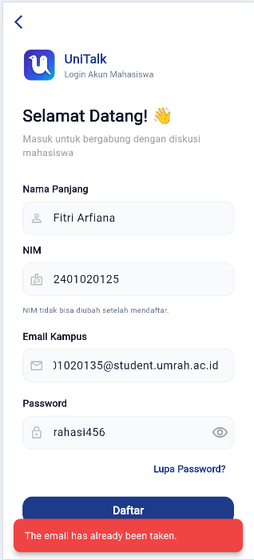|✅|
| TC-02 | Password kurang dari 6 karakter | 1. Buka form Daftar 2. Isi data valid, password `abc12` 3. Tekan Daftar | Registrasi ditolak, ada pesan minimal 6 karakter |Muncul "The password field must be at least 6 characters." Pesan berbahasa Inggris. 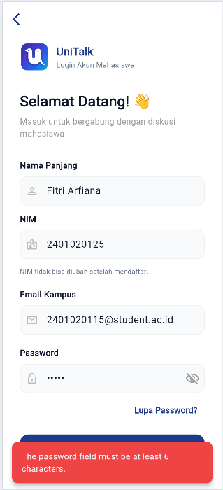|✅|
| TC-03 | Login berhasil | 1. Masuk dengan Akun 2. Email `fitri2401020135@student.umrah.ac.id`, password `password123` 3. Tekan Masuk | Masuk ke beranda, daftar room tampil |Masuk beranda, tampil "Halo, Fitri Arfiana!" dan 4 room Mata Kuliah. 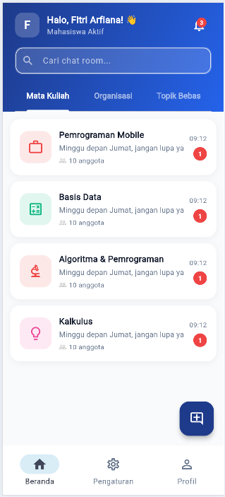|✅|
| TC-04 | Login password salah | 1. Masuk dengan Akun 2. Email benar, password `salah123` 3. Tekan Masuk | Muncul pesan error, aplikasi tidak crash, tetap di halaman login |Muncul "Email atau password s``alah.", tetap di halaman login, tidak crash. 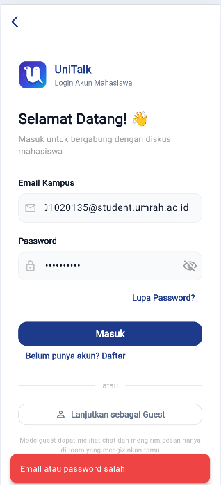|✅|
| TC-05 | Sesi tersimpan | 1. Login berhasil 2. Tutup tab, buka lagi `localhost:<port>` (atau refresh) | Langsung masuk beranda tanpa login ulang |Setelah refresh langsung masuk beranda tanpa login ulang. 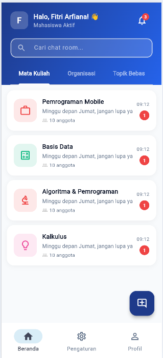|✅|
| TC-06 | Token kadaluarsa kembali ke welcome | 1. Login berhasil, biarkan aplikasi terbuka 2. Di terminal backend: `php artisan migrate:fresh --seed` (token lama mati) 3. Di aplikasi, buka sebuah room atau refresh daftar | Aplikasi otomatis kembali ke welcome |Aplikasi tetap berada di halaman chat room dan tidak kembali ke welcome. 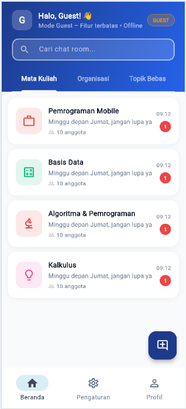|❌|

## B. Mode Guest (US-02)

| ID | Judul | Langkah Pengujian | Hasil Diharapkan | Hasil Nyata | Status |
|----|-------|-------------------|------------------|-------------|--------|
| TC-07 | Masuk sebagai Guest | 1. Welcome → Masuk sebagai Guest | Masuk beranda, daftar room tampil |Masuk beranda dengan lencana GUEST dan daftar room tampil, tetapi header menampilkan "Offline" padahal backend hidup (lihat BUG-01). 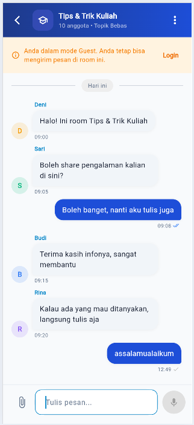|⚠️|
| TC-08 | Guest kirim pesan di room allowGuest | 1. Masuk sebagai Guest 2. Gabung/buka room Topik Bebas 3. Ketik pesan, kirim | Pesan terkirim dan tampil di chat |Pesan "assalamualaikum" terkirim di room Tips & Trik Kuliah dan tampil di chat. Pesan tetap tersimpan: tampil sebagai pesan terakhir room itu (12:49) di akun lain. 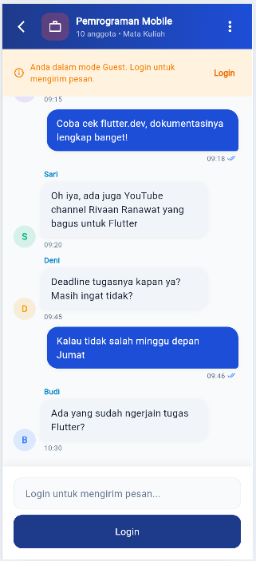|✅|
| TC-09 | Guest posting di room tertutup (UI) | 1. Masuk sebagai Guest 2. Gabung lewat kode ke room Mata Kuliah/Organisasi (bukan allowGuest) 3. Coba kirim pesan | Pengiriman ditolak/dinonaktifkan, ada pesan penjelasan |Muncul banner "Anda dalam mode Guest. Login untuk mengirim pesan." dan kolom input diganti tombol Login. 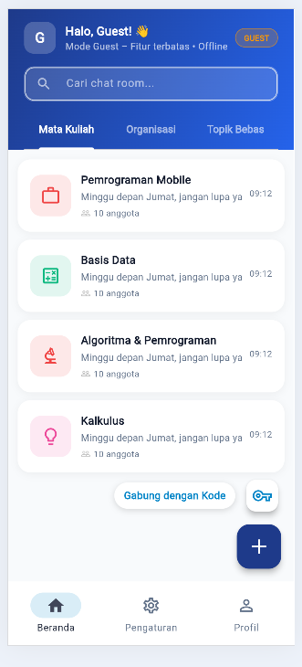|✅|
| TC-10 | Guest tidak bisa buat room | 1. Masuk sebagai Guest 2. Cari tombol buat room | Tombol tidak ada/ditolak, guest tidak bisa membuat room |Tombol + untuk guest hanya membuka opsi "Gabung dengan Kode", tidak ada opsi Buat Room. 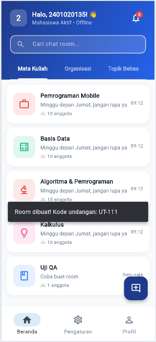|✅|

## C. Buat dan Gabung Room (US-03)

| ID | Judul | Langkah Pengujian | Hasil Diharapkan | Hasil Nyata | Status |
|----|-------|-------------------|------------------|-------------|--------|
| TC-11 | Buat room berhasil | 1. Login 2. Buat room: nama `Uji QA`, kategori Mata Kuliah 3. Simpan | Room terbuat, kode format `UT-111`, pembuat otomatis jadi admin |Room terbuat dan muncul di beranda dengan notifikasi "Room dibuat! Kode undangan: UT-111". Percobaan lain menghasilkan UT-1520 dan UT-8921, jadi panjang kode tidak konsisten (3 dan 4 angka, lihat BUG-05). Status admin pembuat belum diverifikasi di kasus ini. 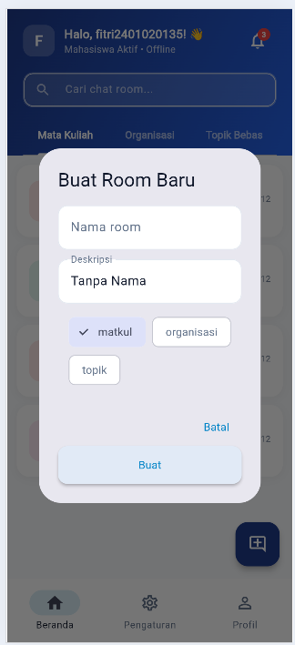|⚠️|
| TC-12 | Room Topik Bebas otomatis allowGuest | 1. Login, buat room kategori Topik Bebas 2. Logout, masuk sebagai Guest 3. Gabung room itu, coba kirim pesan | Guest bisa kirim pesan di room tersebut |Di room Topik Bebas buatan sendiri, guest melihat banner "Anda tetap bisa mengirim pesan di room ini" dan pesan "Test" terkirim (15:45). 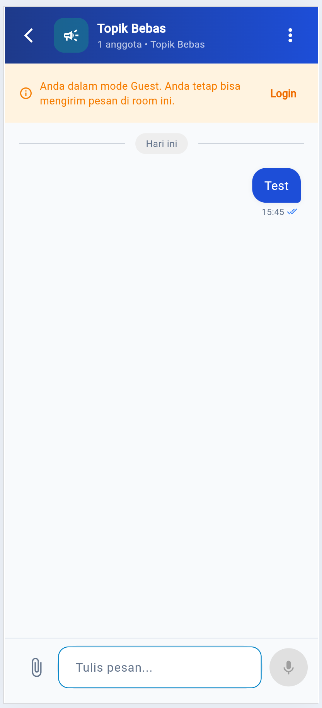|✅|
| TC-13 | Gabung kode tidak peka huruf besar-kecil | 1. Login dengan akun lain 2. Gabung dengan kode ditulis huruf kecil (`ut-1111`) | Berhasil bergabung |Gabung dengan kode huruf kecil berhasil, room Uji QA masuk daftar dan anggotanya menjadi 4. 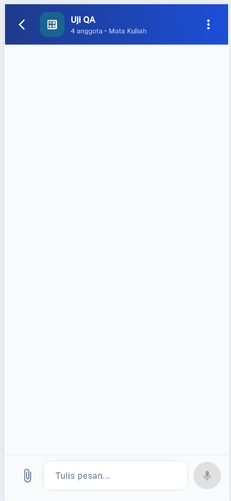|✅|
| TC-14 | Gabung kode salah | 1. Gabung dengan kode `UT-0000` (tidak ada) | Muncul pesan kode tidak ditemukan, tidak crash |Muncul notifikasi "Kode tidak ditemukan", aplikasi tidak crash. 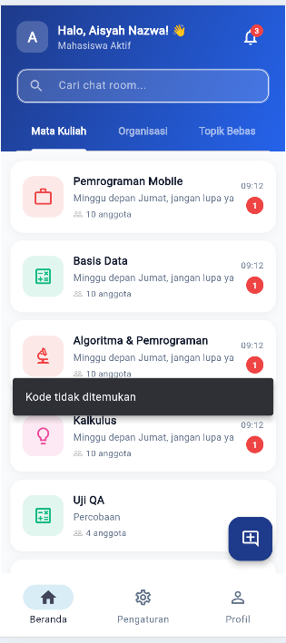|✅|

## D. Chat dan Moderasi (US-04, US-05)

| ID | Judul | Langkah Pengujian | Hasil Diharapkan | Hasil Nyata | Status |
|----|-------|-------------------|------------------|-------------|--------|
| TC-15 | Pesan realtime dua user | 1. Jendela Chrome A (akun Fitri), jendela incognito B (akun Aisyah) 2. Masuk room yang sama 3. A kirim pesan, ukur waktu muncul di B | Pesan muncul di B paling lama 3 detik |Aisyah mengirim "teman-teman" (16:48), pesan muncul di jendela Fitri dalam -- detik.([TC-15-1](screenshots/TC-15-1.png), [TC-15-2](screenshots/TC-15-2.png))|✅|
| TC-16 | Pesan tersimpan di database | 1. Kirim pesan di room 2. Refresh halaman, buka room lagi | Pesan masih ada |Setelah refresh dan buka room lagi, pesan "teman-teman" dan "allo" masih ada. 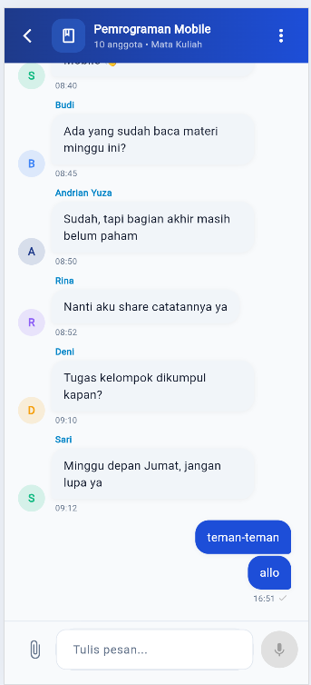|✅|
| TC-17 | Admin hapus pesan siapa pun | 1. Admin (pembuat room) buka room yang berisi pesan anggota lain 2. Hapus pesan anggota tersebut | Pesan terhapus untuk semua pengguna |Muncul dialog "Hapus pesan? ... akan dihapus untuk semua anggota." saat menghapus pesan "teman-teman" milik sendiri. Hasil setelah menekan Hapus: Teman-teman. Skenario admin menghapus pesan anggota lain belum diuji. 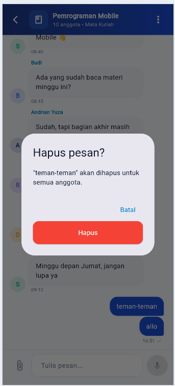|✅|

## E. Offline-First (US-06)

| ID | Judul | Langkah Pengujian | Hasil Diharapkan | Hasil Nyata | Status |
|----|-------|-------------------|------------------|-------------|--------|
| TC-18 | Aplikasi tetap terbuka saat backend mati | 1. Login, buka beberapa room 2. Matikan `php artisan serve` (Ctrl+C) 3. Refresh aplikasi | Aplikasi tetap terbuka, data terakhir tampil dari cache, ada indikator "Offline" |Setelah backend dimatikan dan aplikasi di-refresh, aplikasi tetap terbuka, daftar room tampil dari cache, dan header menampilkan "Offline". 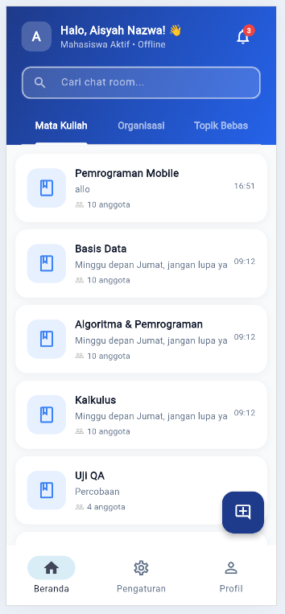|✅|

## Ringkasan Hasil

| Total | Fail | Catatan |
|-------|------|---------|
| 18    |   1  |         |

## Daftar Bug yang Ditemukan

| ID Bug | Dari TC | Deskripsi | Tingkat (Rendah/Sedang/Tinggi) | Screenshot |
|--------|---------|-----------|-------------------------------|------------|
| BUG-01 | TC-07, TC-13 |Setelah masuk sebagai Guest, header menampilkan status "Offline" padahal backend masih aktif. Hal ini membuat informasi koneksi yang ditampilkan tidak sesuai dengan kondisi server.|Rendah-Sedang| `screenshots/TC-07.png` |
| BUG-02 | TC-06 | Setelah token tidak valid akibat database di-reseed, aplikasi tidak otomatis kembali ke halaman welcome dan masih berada di halaman chat room. | Sedang | `screenshots/TC-06.png` |
| BUG-03 | TC-11 | Format kode undangan room tidak konsisten. Ditemukan kode UT-111 (3 angka), UT-1520 dan UT-8921 (4 angka), sedangkan format pada hasil yang diharapkan adalah UT-xxxx. | Rendah | `screenshots/TC-11.png` |
| BUG-04 | TC-01, TC-02 | Pesan validasi ketika email sudah terdaftar dan password kurang dari 6 karakter masih menggunakan bahasa Inggris, sehingga belum konsisten dengan bahasa antarmuka aplikasi. | Rendah | `screenshots/TC-01.png`, `screenshots/TC-02.png` |